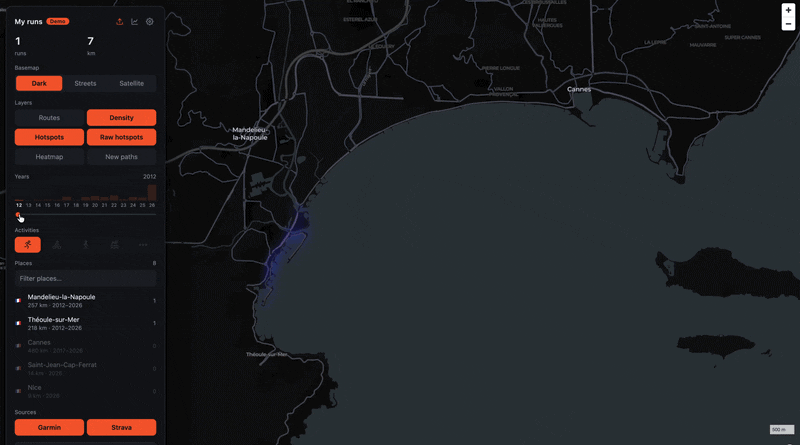
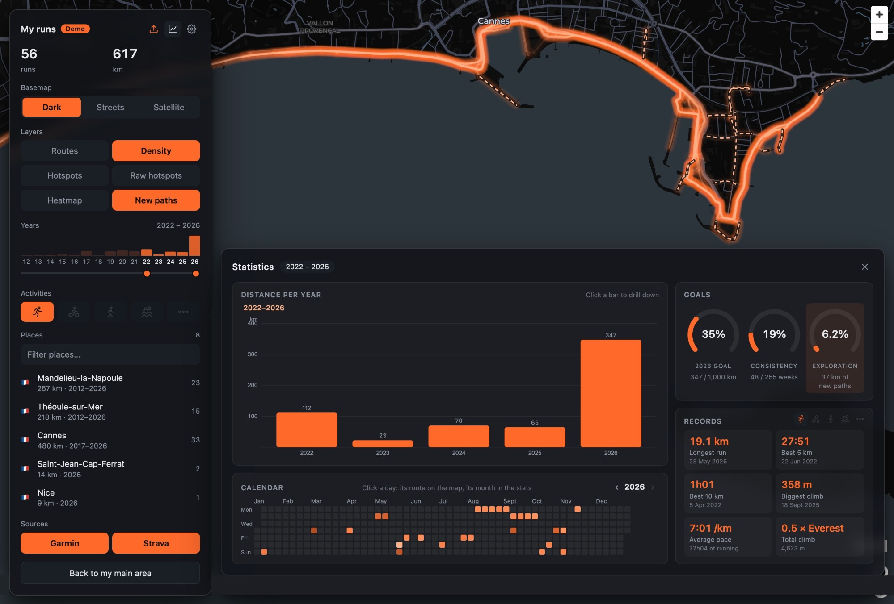
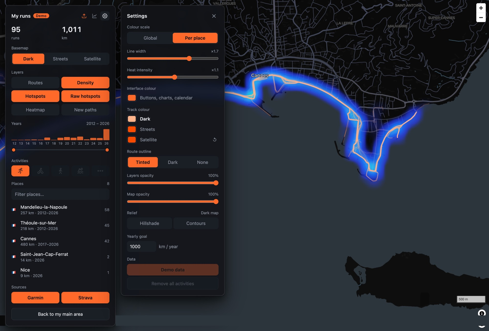
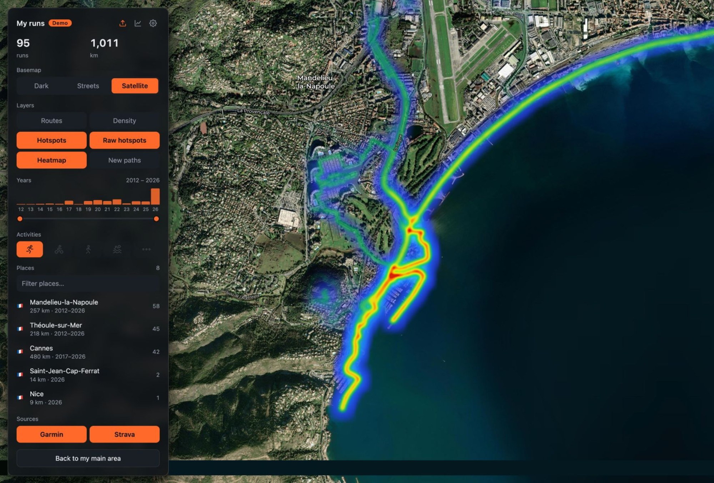
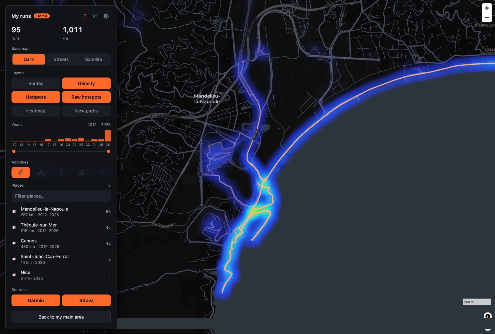

# runheat

Every run you've ever done, on one map.

runheat turns your GPS activities into routes, heatmaps and stats: **where you run most, the paths you've never taken, your records and how the year is going**. Drop your Strava or Garmin export, Nike Run Club
data or plain GPX / TCX / FIT files: everything is processed **in your browser**, nothing is uploaded.



## Features

- **Map layers**
  - **Routes**: every path you've taken, drawn the same.
  - **Density**: brighter where you run more often.
  - **Hotspots**, **Heatmap** and **Raw hotspots**: three views of where you spend your time.
  - **New paths**: what you ran for the first time in the selected period.
- **Basemaps**: Dark, Streets and Satellite, each with optional hillshading and contour lines.
- **Periods**: drill down from years to months to days, or drag a range.
- **Filters** by activity type (run, ride, walk / hike, swim, other) and by source.
- **Places**: your runs grouped by the towns they go through, with a search field.
- **Stats**: distance per year / month / day, a calendar, a yearly goal, consistency and exploration
  gauges, and records (longest run, best 5 km and 10 km, biggest climb, average pace, total climb).
- **Selected run**: shown on its own with direction arrows.
- **Demo data** for a first look: 95 runs on the French Riviera, shifted so they always look recent.

## Screenshots

|                                                                                                                        |                                                                                                 |
| ---------------------------------------------------------------------------------------------------------------------- | ----------------------------------------------------------------------------------------------- |
|  |  |
|                                          |                                   |

## Privacy

Your files never leave your device. They are read by a Web Worker in the page, and the result is stored
in the browser (IndexedDB). There is no server, account or tracking.

The only network requests are for the map: basemap tiles, elevation tiles for the relief, and the
`places.tsv` file served with the app.

## Importing your activities

Open the import panel (the upload icon) and drop files, a folder or an archive.

| Source        | What to drop                                                                                                                                                            |
| ------------- | ----------------------------------------------------------------------------------------------------------------------------------------------------------------------- |
| Strava        | The `.zip` archive from _Settings → My Account → Download or Delete Your Account → Request your archive_. Activity types are read from its `activities.csv`.            |
| Garmin        | The `.zip` from _Account → Data Management → Export Your Data_ (zips nested inside are handled).                                                                        |
| Nike Run Club | Nike has no export button: fetch your data with a script such as [nrc-exporter](https://github.com/yasoob/nrc-exporter) and drop the folder of `.json` or `.gpx` files. |
| Anything else | `.gpx`, `.tcx` or `.fit` files, also gzipped (`.gpx.gz`…), several at once.                                                                                             |

A run that starts within 2 minutes of one you already have is treated as a duplicate, so importing the
same run from two apps is safe. Your activities can be removed from the settings at any time.

## Keyboard shortcuts

| Key         | Action                                    |
| ----------- | ----------------------------------------- |
| `F`         | Filter places                             |
| `S`         | Show / hide the stats                     |
| `,`         | Open / close the settings                 |
| `1` – `3`   | Dark / Streets / Satellite                |
| `⌥1` – `⌥6` | Toggle a layer, in the order of the panel |

Shortcuts are also shown in the tooltips.

## Development

Requires Node.js 20.19+ or 22.12+.

```bash
npm install
npm run dev       # dev server
npm run build     # production build in dist/
npm run preview   # serve the build locally
npm run check     # Prettier + ESLint (npm run format / npm run lint to fix or lint only)
```

The stack is Svelte 5, Vite and MapLibre GL JS, plus d3 for the charts, fflate for archives and
maplibre-contour for the contour lines.

### Releasing

Versions follow [SemVer](https://semver.org/). One command does the whole release:

```bash
npm run release:patch   # or release:minor, release:major
```

It runs the checks and the build, bumps `package.json`, commits and tags `vX.Y.Z`, then pushes with the tag.
The push deploys the site, and the tag creates the GitHub Release
([`.github/workflows/release.yml`](.github/workflows/release.yml), notes generated from the commits). The
version is shown at the bottom of the settings.

### Deploying

`npm run build` produces a static site in `dist/` that works from any folder or subdomain.

Every push on `main` is built and published on **GitHub Pages** by
[`.github/workflows/deploy.yml`](.github/workflows/deploy.yml) (lint included). To enable it once: repository
_Settings → Pages → Source: GitHub Actions_. The workflow passes the Pages address as `SITE_URL`.

Link previews (Open Graph) need absolute URLs. Set the address of your site at build time so it doesn't
have to live in the repository, either in the environment or in a git-ignored `.env` file:

```bash
SITE_URL=https://example.com/ npm run build
```

## Credits

- Basemaps: [CARTO](https://carto.com/basemaps) (Dark Matter, Voyager) with data ©
  [OpenStreetMap](https://www.openstreetmap.org/copyright) contributors; satellite imagery ©
  [Esri](https://www.esri.com/), Maxar, Earthstar Geographics. Their own terms of use apply.
- Elevation: [Terrain Tiles](https://registry.opendata.aws/terrain-tiles/) on AWS Open Data
  (Terrarium encoding).
- Town names: [GeoNames](https://www.geonames.org/), CC BY 4.0.
- Libraries: [MapLibre GL JS](https://maplibre.org/), [maplibre-contour](https://github.com/onthegomap/maplibre-contour),
  [Svelte](https://svelte.dev/), [d3](https://d3js.org/), [fflate](https://github.com/101arrowz/fflate).

## License

[MIT](LICENSE)
